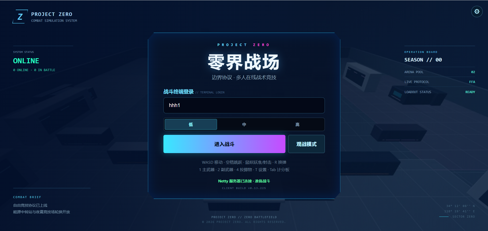
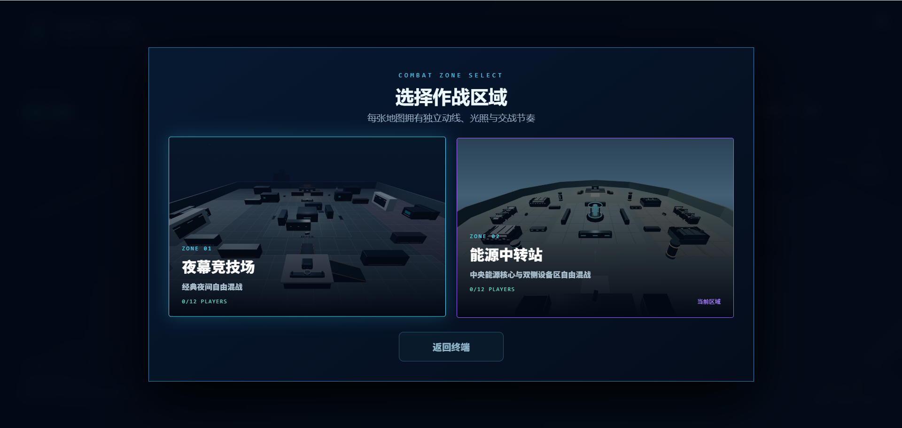
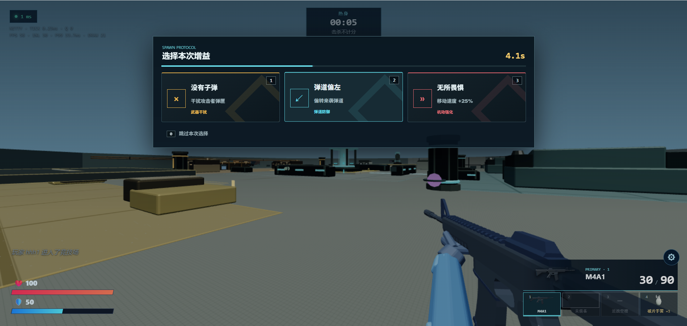
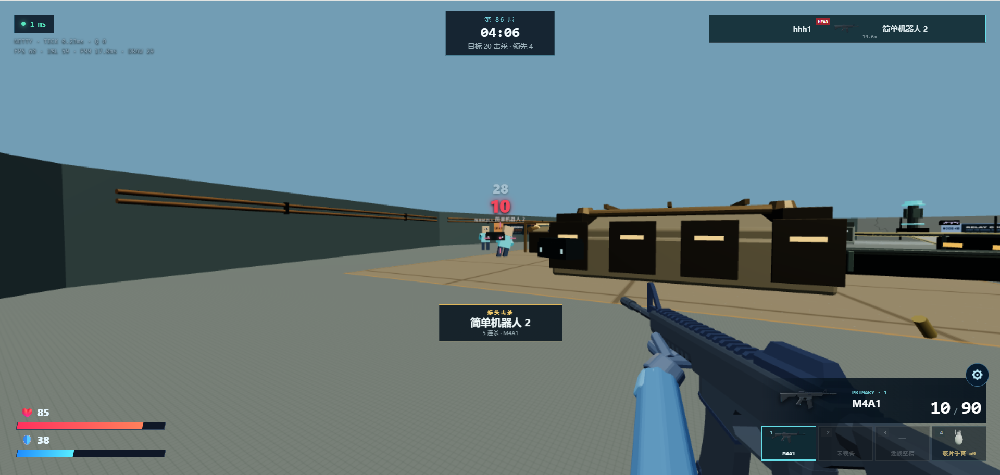

# Zero Boundary Arena

Zero Boundary Arena（零界战场）是一个基于浏览器的多人 FPS 原型。客户端使用 Three.js，HTTP 服务使用 Spring Boot，实时对战使用 Netty WebSocket。

当前基线版本为 `0.13.225`，用于展示服务端权威战斗、固定 Tick 房间模拟、浏览器 3D 渲染、武器表现、观战模式和基础 FFA 对局。

## 成果展示









## 构建

需要 JDK 17。仓库提供 Maven Wrapper，无需单独安装 Maven。

Windows PowerShell：

```powershell
.\mvnw.cmd clean test
.\mvnw.cmd -Pproduction package
```

Linux/macOS：

```bash
./mvnw clean test
./mvnw -Pproduction package
```

生产 JAR 位于 `target/production-build/`。默认 HTTP 端口为 `8080`，Netty WebSocket 端口为 `8081`。

本地开发可执行：

```powershell
.\mvnw.cmd spring-boot:run
```

## 配置

- `src/main/resources/application.yml`：房间容量、比赛和机器人参数
- `src/main/resources/weapons.yml`：武器与伤害参数
- `src/main/resources/maps/`：服务端地图碰撞和出生点
- `src/main/resources/static/assets/weapons/manifest.json`：客户端武器资源

服务端是移动、射击、散布、伤害、弹药和比赛结果的最终裁决者。

## 项目边界

这是研究与原型项目，不是可直接运营的完整商业游戏。它未提供完整的账号、数据库、匹配、内容治理、监控告警、灾难恢复或正式 SLA。部署者需要自行完成安全加固、容量验证、隐私与当地法律合规，并承担自行构建、修改、部署或运营产生的风险和费用。

软件按“原样”提供，不承诺适销性、特定用途适用性、持续可用性、安全性、性能或无侵权。完整责任限制以 [Apache License 2.0](LICENSE) 为准。

## 许可

项目原创源代码使用 [Apache License 2.0](LICENSE)。模型、贴图和第三方库遵循各自的许可证与署名要求，详见 [THIRD_PARTY_ASSETS.md](THIRD_PARTY_ASSETS.md) 和资源旁的许可证文件。
